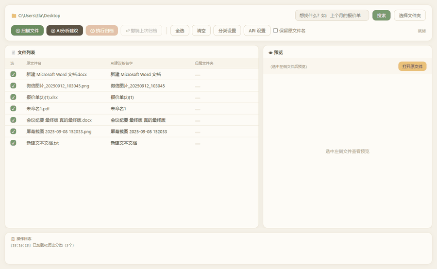

# 文件 AI 整理工具

> 让 AI 读懂你的文件，自动改名、自动归档。桌面不再乱。

一个运行在本机的 Windows 桌面小工具：扫描文件夹里散落的文件，让 AI 阅读文件内容后给出**新的文件名**和**归属文件夹**建议，你确认后一键完成重命名 + 移动；还支持用自然语言找文件，以及一键撤销。

## ✨ 功能

- **AI 重命名** —— 根据文件内容起一个一眼就能看懂的名字
- **AI 自动归档** —— 自动归到合适的文件夹；没有合适的分类时自动新建
- **三层分类体系** —— 现有文件夹 + 你自己的分类 + AI 积累的分类（按文件夹独立保存）
- **自然语言搜索** —— 输入「上个月那个报价单」直接定位文件
- **文件预览** —— PDF 首页缩略图；Word / PPT / Excel / 文本显示内容摘要
- **归档前确认 + 一键撤销** —— 移动前先给你看清楚，出错可一键还原
- **多 AI 服务商** —— DeepSeek / Kimi / 智谱 / 通义 / 硅基流动 / OpenRouter / OpenAI / 自定义
- **本地模型（隐私模式）** —— 用 Ollama 在本机跑 AI，**文件内容不会上传**
- **支持格式** —— PDF / Word(.docx) / PPT(.pptx) / Excel(.xlsx) / txt / csv / md / json / 代码等

## 📷 演示



> 上图由真实界面渲染而成（演示数据）。

## 🚀 快速开始

### 1. 环境要求

- Windows
- Python 3.10+（开发环境为 3.13）

### 2. 安装依赖

```bash
pip install -r requirements.txt
```

### 3. 配置 AI 服务商

首次启动会自动弹出「API 设置」窗口，**选择服务商 + 填入你自己的 API Key** 即可（按量计费）。

内置预设：DeepSeek（默认）/ Kimi / 智谱 GLM / 通义千问 / 硅基流动 / OpenRouter / OpenAI / **本地模型** / 自定义。

- 想省事 → 选 **DeepSeek**，填上 Key
- 想免费 + 隐私 → 选 **本地模型**（需先装 Ollama，见下）
- 想用别的 → 选「自定义」，填任意 OpenAI 兼容的接口地址和模型名

点 **「测试连接」** 可以立刻验证配置是否可用。

#### 本地模型（隐私模式）

```
1. 安装 Ollama       https://ollama.com
2. 拉取一个模型      ollama pull qwen2.5:7b
3. 打开「API 设置」→ 服务商选「本地模型（隐私模式）」→ 测试连接 → 保存
```

启用后 **AI 完全在你本机运行，文件内容不会发送到任何服务器**。代价是质量与速度取决于电脑配置（建议 8GB 以上内存，纯 CPU 会较慢）。

### 4. 运行

```bash
python "桌面文件AI整理工具-web.py"
```

## 🧭 使用流程

1. **选择文件夹** —— 选要整理的目录（默认是桌面）
2. **① 扫描文件** —— 列出散落的文件（自动跳过临时文件、快捷方式、安装包）
3. **② AI 分析建议** —— 逐个读取内容，给出新文件名 + 归属文件夹
4. **检查建议** —— 点文件看预览；双击可手动改名字或分类
5. **③ 执行归档** —— 二次确认后批量重命名 + 移动
6. 出错了？点 **↩ 撤销上次归档** 一键还原

> 提示：勾选「保留原文件名」则只移动、不改名。

## 🔍 自然语言搜索

在顶部搜索框输入「上个月那个报价单」，AI 会在当前文件夹（含所有子目录）里找出最相关的文件，双击结果直接用默认程序打开。

## 📁 数据存放位置

所有本地数据都在用户目录下，不会进入项目文件夹：

| 文件 | 用途 |
|---|---|
| `~/.fileai/config.json` | 你的 API Key |
| `~/.fileai/categories_history.json` | 各文件夹积累的 AI 分类 |
| `~/.fileai/last_archive.json` | 最近一次归档记录（用于撤销） |

（Windows 下 `~` 即 `C:\Users\你的用户名`）

## 🔒 隐私说明

| 模式 | 你的文件内容会去哪里 |
|---|---|
| 云端服务商（DeepSeek / Kimi / 智谱 / 通义 / OpenRouter / OpenAI…） | 会发送给**该服务商的服务器** |
| **本地模型（Ollama）** | **不离开你的电脑** |

- 你的 API Key 只保存在本机 `~/.fileai/config.json`，不会上传到任何地方。
- 用云端服务商时，程序会把**文件名和文件内容摘要**发送给对应服务商——这是 AI 理解文件所必需的。**整理涉密或高度敏感的文件时，请改用「本地模型」模式。**
- 除此之外的所有操作都在你的本机完成。

## 💰 费用说明

使用你自己的 DeepSeek API Key，按 token 计费。整理单个文件通常只消耗很少的 token，具体价格以 DeepSeek 官方为准。

## ⚠️ 免责声明

本工具会**重命名并移动你的文件**。虽然已提供归档确认与撤销功能，仍建议对重要文件先行备份。因使用本工具造成的任何数据损失，作者不承担责任。

## 🗺 Roadmap

已完成：

- [x] 归档前二次确认 + 一键撤销
- [x] 多 AI 服务商 / 本地模型
- [x] 搜索重构（本地预筛 + AI 排序）
- [x] 文件名清洗与路径穿越防护

待做：

- [ ] 分析并发 / 可取消（文件多时较慢）
- [ ] 界面内管理 AI 积累的分类
- [ ] 图片预览
- [ ] 文件夹监控：新文件自动归档
- [ ] 打包成免安装 exe

## 📄 License

[MIT](LICENSE)